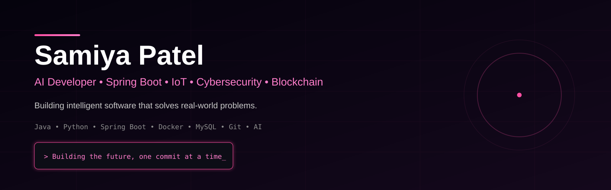

  

<h1 align="center">Hi, I'm Samiya Patel 👋</h1>

  <b>Backend & Android Developer · Building AI Agents · Final-year CSE @ VIIT Pune</b>

  

  
  

---

### 🙋‍♀️ About Me

- 💼 **Freelance developer** – built **Call IQ**, an Android + PHP call-tracking CRM that has recorded every sales call since Sep 2026 across 15+ SIM cards
- 🤖 Building **AI agents** with fault-tolerant LLM pipelines (Groq → Ollama → offline rules)
- 📄 **Co-author, IEEE ESCI 2026** – *MOVIS: Unified Architecture for Human Profiling*
- 🎓 B.Tech CSE (IoT, Cybersecurity & Blockchain), VIIT Pune – graduating 2027
- 🔍 Open to **SDE / Backend / Android** internships and full-time roles

---

### 🚀 Featured Projects

| Project | What it does | Stack |
|---|---|---|
| 🧭 [**Coordina**](https://github.com/Sam786-web/Coordinia_W_PS1) | AI agent that turns a GitHub repo into tasks and follows up with teammates on Telegram | Python, FastAPI, React, Groq, Ollama |
| 🎙️ [**AI Meeting Agent**](https://github.com/Sam786-web/ai-meeting-agent) | Records Meet / Teams / Zoom / WebEx and transcribes offline into meeting reports | Java, Spring Boot, MySQL, Vosk, Docker |
| 📱 **Call IQ** *(client project, private)* | Automatic dual-SIM call tracking synced to an EdTech CRM | Kotlin, WorkManager, PHP, MySQL |
| ♻️ **BEELMS** | Blockchain tracking of e-waste from manufacturer to recycler | Solidity, Web3.js, MetaMask |

---

### 🛠️ Tech Stack

  

---

### 📊 GitHub Stats

  
  

  

